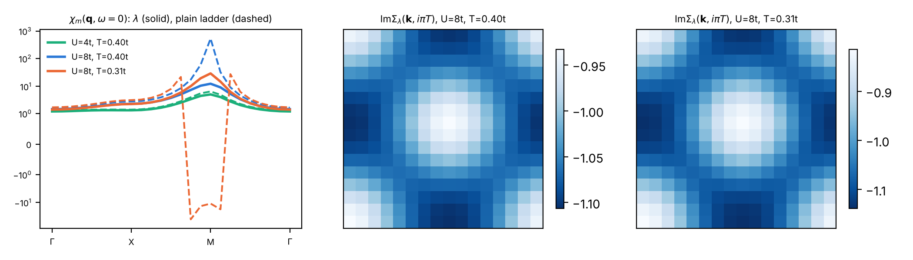

# λ-corrected ladder DΓA — 2D Hubbard model, half filling

Setup: t = 0.25, a 16×16 k mesh, and a DMFT vertex from finite-T ED with 2 bath sites, spin-resolved.
The frequency box is 16 fermionic × 15 bosonic frequencies; the bubble is added outside the box (n_tail = 256).
Moriya λ is applied in the magnetic channel (Katanin, Toschi, Held, PRB 80, 075104 (2009)).
Reproduce with `python benchmarks/lambda_dga/run_lambda_dga.py` (about 35 min on 2 cores without cache).

| check | U = 4t, T = 0.40t | U = 8t, T = 0.40t | U = 8t, T = 0.31t |
|---|---|---|---|
| λ = 0 reproduces the plain ladder (max \|ΔΣ\|) | 2e-16 | 4e-15 | 3e-15 |
| local spin sum, target (DMFT, same box + tail) | 0.2977 | 0.3524 | 0.3268 |
| lattice sum, plain ladder | 0.3165 | 0.7828 | 0.0048 (pole crossed) |
| lattice sum, λ-DΓA | 0.2977 | 0.3524 | 0.3268 |
| λ_m (λ_min = −1/χ_m(Q,0)) | 0.0437 | 0.0796 | 0.1238 (> λ_min = 0.0894) |
| χ_m(Q,0), plain ladder | 6.41 | 537.6 | **−11.2** (below DMFT T_N) |
| χ_m(Q,0), λ-DΓA | 5.01 | 12.3 | 29.1 |
| χ_m(Q,0), TPSC (χ_sp/2) | 6.51 | — | — |
| Im Σ(iπT), DMFT | −0.128 | −0.963 | −0.900 |
| Im Σ(π,0), plain ladder | −0.186 | −5.37 | **+2.72** (acausal) |
| Im Σ(π,0) / Σ(π/2,π/2), λ-DΓA | −0.146 / −0.128 | −1.106 / −1.066 | −1.139 / −1.075 |

What the numbers show:
* **Exactness.** The λ-DΓA formula is a rewrite of the plain ladder with triangular vertices γ_r. At λ = 0 the two agree to machine precision.
* **Sum rule.** The plain ladder violates the local spin sum rule: by 6% at U = 4t and by a factor 2.2 at U = 8t. λ_m restores it exactly.
* **Mermin–Wagner.** Below the DMFT Néel temperature (U = 8t, T = 0.31t) the plain ladder has crossed its pole. It gives χ_m(Q) < 0 and a self-energy with the wrong sign (Im Σ > 0). With λ_m > λ_min, χ_m(Q) stays positive and finite. It grows as T falls (12.3 → 29.1), so the 2D system has no long-range order at finite T.
* **Momentum structure.** At U = 8t, scattering is strongest at the antinode, (π,0) more than (π/2,π/2). This is the precursor of the antinodal pseudogap.
* **Cross-check.** At U = 4t, λ-DΓA and TPSC agree on χ_m(Q,0) within 25% (5.0 vs 6.5). This is not a sharp test: both are approximations.

## Choice of sum-rule target (honest note)

The finite vertex box cuts off part of the vertex corrections. Two choices of target were run:

* **Box-consistent target (default).** The DMFT local χ_m is summed over the same box plus the bubble tail. Truncation errors largely cancel between the lattice side and the local side.
* **Exact target (`docc=` option).** The target is (n − 2⟨d⟩)/2, for example 0.450 vs 0.352 at U = 8t, T = 0.40t. It is applied to a lattice χ that is still truncated, so it is inconsistent. It gives a smaller λ, a larger χ_m(Q) (33 / 188) and a stronger Σ (−2.0 / −2.5).

The spread between the two choices is the box error of this demonstration. Quantitative λ-DΓA needs larger boxes, which the faster vertex (next item) makes affordable.
