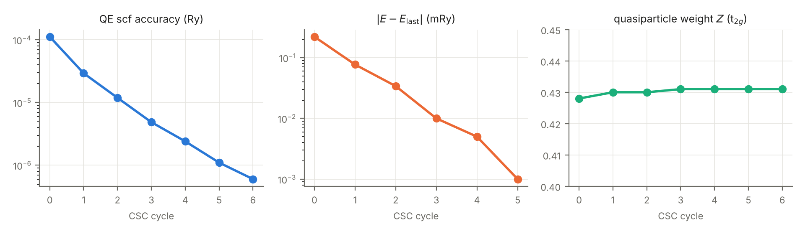

# Fully charge self-consistent DFT+DMFT for SrVO₃ (Quantum ESPRESSO 7.6 + Wannier90 4.0.3 + feynlab)

Reproduce: `NP=4 python benchmarks/qe_csc/run_srvo3.py` (the UPF files must be in the working directory).
Report: `python benchmarks/qe_csc/make_report.py csc.log fig.png`.

## Setup

| item | value |
|---|---|
| structure | cubic perovskite, a = 7.2612 bohr (3.8425 Å) |
| DFT | PBE, PSlibrary ultrasoft (Sr spn, V spnl, O n), ecutwfc/ecutrho = 40/320 Ry, 8×8×8 k, Fermi–Dirac smearing with degauss = k_BT (β = 40 eV⁻¹) |
| correlated window | bands 21–23 (isolated t₂g, 1 electron), Wannier90 projections V:d_xz, d_yz, d_xy, no disentanglement; spreads 1.885 Ų |
| interaction | Kanamori, U = 5 eV, J = 0.75 eV, FLL double counting |
| solver | multi-orbital Lanczos ED, 3 orbitals × 2 bath sites (9 sites), finite-T Boltzmann average over low-lying states |
| CSC | 45 DMFT iterations in cycle 0, 10 per later cycle (warm-started Σ); QE density step with mixing_beta = 0.3, electron_maxstep = 1 |
| stop criteria | QE scf accuracy < 1e-6 Ry, \|ΔE\| < 2e-5 Ry, window charge stable, at least 3 cycles |
| cost | 2 MPI ranks, 9350 s for 7 cycles (≈ 20 min per cycle, mostly DMFT) |

## 1. Plumbing test (U = 0)

| check | result |
|---|---|
| max \|ΔN(k)\| | 1.5·10⁻⁷ (Matsubara truncation) |
| μ_DMFT vs E_F(QE) | equal |
| QE total energy after reading the archive | −317.45621426 Ry vs −317.45621425 Ry (DFT); scf accuracy 1.4·10⁻⁹ Ry |

## 2. CSC convergence (U = 5 eV, J = 0.75 eV)

| cycle | Z (t2g) | E_F (eV) | QE scf accuracy (Ry) | E (Ry) | ΔE (Ry) | window charge |
|---|---|---|---|---|---|---|
| 0 | 0.428 | 12.7323 | 1.12e-04 | -317.427970 | — | 1.00000 |
| 1 | 0.430 | 12.7368 | 2.93e-05 | -317.428114 | -1.4e-04 | 1.00000 |
| 2 | 0.430 | 12.7455 | 1.19e-05 | -317.428157 | -4.3e-05 | 1.00000 |
| 3 | 0.431 | 12.7413 | 4.86e-06 | -317.428181 | -2.4e-05 | 1.00000 |
| 4 | 0.431 | 12.7448 | 2.40e-06 | -317.428186 | -5.0e-06 | 1.00000 |
| 5 | 0.431 | 12.7420 | 1.10e-06 | -317.428192 | -6.0e-06 | 1.00000 |
| 6 | 0.431 | 12.7440 | 6.00e-07 | -317.428191 | +1.0e-06 | 1.00000 |

* The cycle converges geometrically: the scf accuracy falls by a factor ≈ 2.2 per cycle, and the energy is stable to 10⁻⁶ Ry.
* The correlated window always contains one electron. By cubic symmetry the t₂g occupations stay at 1/3 each.
* The DMFT density redistributes charge *inside* the window between Bloch states (\|ΔN\|_max ≈ 0.55). The QE functional
  at this density lies 28.0 mRy above the DFT minimum (−317.42819 vs −317.45621 Ry), as it must.
* E_F moves by +12 meV. Z changes from 0.428 (one-shot, cycle 0) to 0.431 (CSC). This change is no larger than the
  residual DMFT convergence of the warm-started loop.
* So CSC effects are small for SrVO₃, which has an isolated t₂g manifold and occupations fixed by symmetry. This
  matches the small CSC corrections reported by Beck et al. (2022) for the related CaVO₃.
* The absolute Z depends on the solver: a 2-site-per-orbital bath is a coarse discretisation. For quantitative
  values, cross-check with `solver='cthyb'`.

## 3. Solver cross-check that motivated v1.2 fixes (single band, n = 0.8, U = 2, β = 10, t = 0.25)

| solver | Z | μ |
|---|---|---|
| ED (DFTDMFT, after bath-level fix) | 0.5024 | −0.257 |
| Lanczos (DFTDMFT) | 0.5025 | — |
| matrix CT-HYB | 0.497 | −0.248 |

Before v1.2, `DFTDMFT(solver='ed')` subtracted μ from the fitted bath levels a second time. This emptied the bath as μ
drifted, and gave a spurious Mott drift for SrVO₃ (Z → 0.01). Regression test: `test_dftdmft_bath_levels_measured_from_mu`.

Reference: S. Beck, A. Hampel, O. Parcollet, C. Ederer, A. Georges, J. Phys.: Condens. Matter 34, 235601 (2022).
