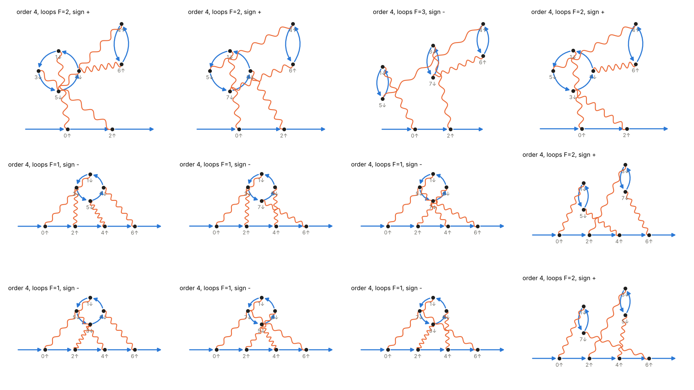

# Tutorial 2 — Feynman diagrams as data structures

<!-- gs-watermark -->
> **© 2026 Gokaran Shukla** · part of [feynlab](https://github.com/Gokaran-Shukla/feynlab) · MIT License — any reuse must keep this copyright notice and credit the author.


## Representation

A Green's-function diagram of order n is fixed by *who connects to whom*:

* interaction line i joins internal vertices `2i` and `2i+1`;
* every internal vertex emits one fermion line and receives one;
* `X` (= −1) is the external creation point, `Y` (= −2) the external annihilation point.

So a diagram is a bijection `succ: {X, 0..2n−1} → {Y, 0..2n−1}`. Following `succ` from X gives the
**open line**; the remaining cycles are the **closed fermion loops** (F of them, sign (−1)^F).

Two families:

| family | interaction | labelled diagrams at order n | symmetry group |
|---|---|---|---|
| `generic` | spin-independent v(r−r′) (electron gas, Mattuck Chs. 4, 9, 10) | (2n+1)! | n!·2ⁿ (relabel lines, swap ends) |
| `hubbard` | U n↑n↓, spin-conserving lines | (n+1)!·n! | n! |

Connected diagrams with fixed external legs have **no non-trivial automorphisms**, so the number of
topologically distinct diagrams is simply (number of labelled ones)/|group|. `count_diagrams` relies on
this (and asserts it).

## Counting and classifying

```python
from feynlab.diagrams.enumerate import count_diagrams, unique_diagrams

for n in (1, 2, 3):
    print(n, count_diagrams(n, "generic", "G"),        # 2, 10, 74   (706 at n=4)
             count_diagrams(n, "generic", "proper"),   # 2, 6, 42
             count_diagrams(n, "generic", "improper")) # 0, 4, 32

# Molinari's loop-resolved count with the Hartree propagator (no tadpoles):
print(count_diagrams(3, "generic", "proper", exclude_tadpoles=True, by_loops=True))
# {0: 10, 1: 9, 2: 1}   ->  10 + 9 l + l^2   (PRB 71, 113102 (2005))
```

Classification methods on a `Diagram`:

| method | meaning (Mattuck section) |
|---|---|
| `is_connected()` | linked diagram (5.4 linked-cluster theorem) |
| `is_proper()` | one-particle irreducible = proper self-energy part (10.2) |
| `has_tadpole()` | contains a Hartree-type insertion attached by a single interaction line (4.7) |
| `has_self_energy_insertion()` / `is_skeleton()` | "clothed skeleton" test (11.1) |
| `n_loops`, `sign` | closed loops F and (−1)^F (9.6 rules) |
| `canonical_key()` | topological-equivalence key (5.2 ex., 9.5) |

## Drawing

```python
from feynlab.diagrams.draw import draw_all
draw_all(unique_diagrams(4, "hubbard", "proper", True), ncol=4, fname="sigma4.png")
```


## Evaluating diagrams — bare diagrammatic Monte Carlo

`diagrams.evaluate` integrates each diagram over its internal imaginary times by Monte Carlo
(Feynman rules: (−U)ⁿ(−1)^F ∏G₀). This is the simplest form of **diagrammatic Monte Carlo**:

```python
from feynlab.core.matsubara import MatsubaraGrid
from feynlab.diagrams.evaluate import sigma_series
g = MatsubaraGrid(10.0, 512)
ser = sigma_series(g, 1/g.iw, U=1.0, max_order=4, n_iw=2)   # Hubbard atom at half filling
for n, (val, err, ndiag) in ser.items():
    print(n, ndiag, val, err)
```

Check yourself: for the half-filled Hubbard atom the exact self-energy is U/2 + U²/(4iω), so the
2nd-order diagram already gives everything and the sums of the 2 third-order and 12 fourth-order
diagrams **must vanish** (individually they don't!). The benchmark suite verifies this, and also
that the order-2…4 series reproduces exact diagonalization for an Anderson impurity at U = Γ-scale.

## Exercises
1. Show that `count_diagrams(2,'generic','G') - count_diagrams(2,'generic','proper')` equals the number of products of two first-order self-energies (2×2 = 4).
2. List the 3 non-skeleton fourth-order Hubbard diagrams (`kind='proper'` minus `kind='skeleton'`) and identify the inserted self-energy.
3. Evaluate each fourth-order diagram for the atom separately and observe the cancellation pattern.
