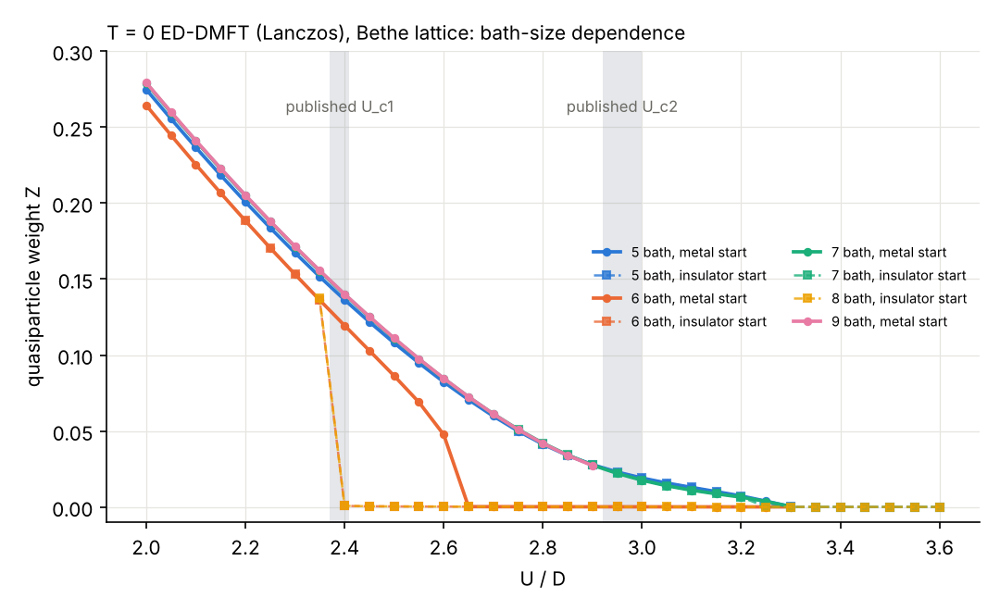

# Tutorial 8 — The Mott transition with exact-diagonalization DMFT (T = 0, Lanczos)

Goal: reproduce the published critical interactions of the half-filled Hubbard model on the Bethe lattice
(DMFT, half bandwidth D = 1):

* **U_c1 = 2.39 ± 0.02 D** (the insulator disappears) and
* **U_c2 = 2.92–3.0 D** (the metal disappears, Z → 0),

the consensus of NRG, ED, DMRG and strong-coupling perturbation theory (Bulla, PRL 83, 136 (1999);
Karski, Raas & Uhrig, PRB 72, 113110 (2005) and references therein).

## 1. The solver

At T = 0 only the impurity-cluster ground state and its ±1-electron excitations enter G(iω). feynlab
therefore uses

* **sector-resolved sparse Hamiltonians** (N↑, N↓ conserved),
* **Lanczos ground state** in the sectors around half filling (degenerate ground states averaged),
* **continued-fraction Green function** G(z) = ⟨0|d (z−H+E₀)⁻¹ d†|0⟩ + ⟨0|d† (z+H−E₀)⁻¹ d|0⟩
  (`feynlab.qmc.ed_sector.LanczosED`, validated against full diagonalization to 1e-10),
* a **Caffarel–Krauth bath fit** on a fictitious Matsubara grid (β_fit = 200) with three robustness features:
  multi-start minimisation, bounded bath levels |ε_l| ≤ 3D, and the exact **sum rule** Σ V_l² = ∫ε²ρ(ε)dε
  (without it the bath under-weights Δ, shrinking the effective bandwidth and pulling U_c down by ~10%).

8–9 bath sites take ~1–2 s per DMFT iteration.

```python
from feynlab.dmft.bethe import BetheDMFT
d = BetheDMFT(beta=200, U=2.6, n_iw=1024)          # beta = fictitious grid; the cluster is at T = 0
r = d.solve('ed', n_iter=150, mix=0.5, tol=1e-6, ctint_kwargs=dict(n_bath=7))
print(r['Z'])                                        # ~0.085
```

## 2. Following the two branches (hysteresis)

```bash
python benchmarks/ed_dmft/mott_scan.py 7 metal       # metallic branch, U = 2.0 -> 3.6, warm starts
python benchmarks/ed_dmft/mott_scan.py 6 insulator   # insulating branch, U = 3.6 -> 2.2
python benchmarks/ed_dmft/analyze.py                 # table + figure
```
Each point starts from the converged bath and self-energy of the previous U (adiabatic continuation),
exactly as one does for a first-order transition.

## 3. The bath-size parity effect (the key lesson)

| bath sites | cluster sites | ground state | good for |
|---|---|---|---|
| odd (5, 7, 9) | even | singlet, includes a zero-energy bath level | **metal** → U_c2 |
| even (6, 8) | odd | spin doublet, no zero mode | **insulator** → U_c1 |

* With an **even** bath the cluster cannot form the Kondo singlet that carries the quasiparticle peak, so the
  metal collapses too early (6 bath: ≈2.6–2.7D).
* With an **odd** bath the zero-energy level hybridises with the local moment; at T = 0 Lanczos resolves an
  arbitrarily small Kondo scale, so the insulator acquires a spurious resonance and disappears too late
  (7 bath: ≈3.2D).

Hence: **U_c2 from odd baths, U_c1 from even baths.** Results (`benchmarks/ed_dmft/TABLE.md`):

| n_bath | parity | U_c2 (linear Z->0) | U_c2 (metal collapse) | U_c1 (insulator lost) |
|---|---|---|---|---|
| 5 | odd | 2.956 | 3.275 | 3.225 |
| 6 | even | 2.743 | 2.625 | 2.375 |
| 7 | odd | 2.955 | 3.275 | 3.225 |
| 8 | even | nan | nan | 2.375 |
| 9 | odd | 2.953 | nan | nan |
| ref | | 2.92-3.0 | | 2.39 ± 0.02 |

**Converged values: U_c2 = 2.955 ± 0.002 D (odd baths 5, 7, 9; consensus 2.92–3.0 D) and U_c1 = 2.375 ± 0.025 D (even baths 6, 8; consensus 2.39 ± 0.02 D).** For comparison IPT gives ≈2.5 / 3.3 D. The 'wrong-parity' entries (odd-bath U_c1, even-bath U_c2) are the artifacts explained above.



## 4. Defining U_c2 with a finite bath

With a finite bath Z(U) does not vanish linearly at U_c2: it develops a small tail (Z ~ 10⁻²–10⁻³) before
the metallic solution is lost. Two estimators are reported:

* **linear extrapolation** of Z(U) → 0 in the window 0.04 ≤ Z ≤ 0.15 — the regime where Z is resolved by the
  bath, *window fixed before looking at the result*; this is the standard practice and the number compared
  with the literature;
* **collapse point** (last U with a metallic solution) — an upper bound affected by the finite-bath tail.

## 5. Exercises
1. Repeat the 7-bath metallic scan with `sum_rule` removed from `fit_bath` (edit the call in `dmft/bethe.py`):
   how much does U_c2 drop, and why?
2. Run the 6-bath *metallic* branch and the 7-bath *insulating* branch and explain both failures with the
   ground-state parity table above.
3. Use `BetheDMFT.spectral_function` (Padé) or `core.maxent` on the U = 2.8D, 7-bath solution and identify the
   quasiparticle peak and the Hubbard bands at ±U/2.
4. Compare Z(U = 2.0D) for 5, 7 and 9 bath sites with IPT (0.346) and CT-INT at β = 50.
